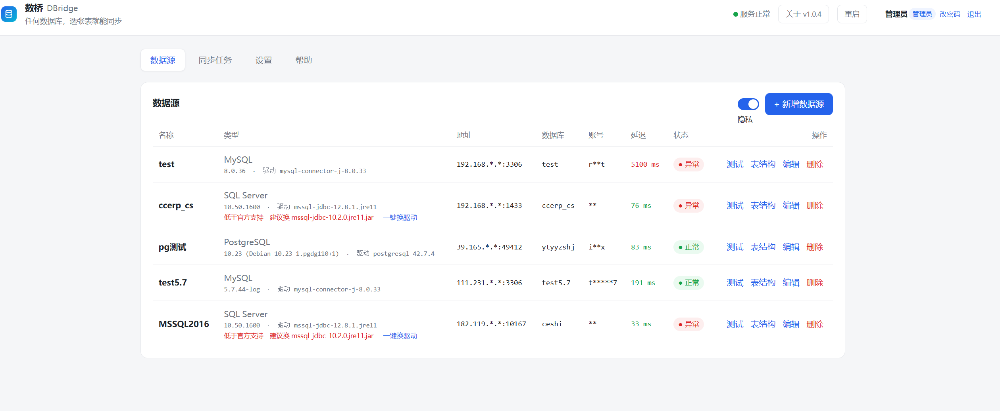
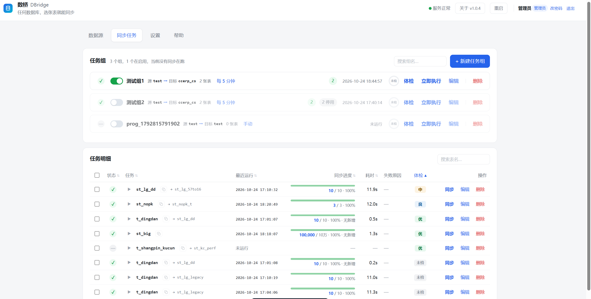
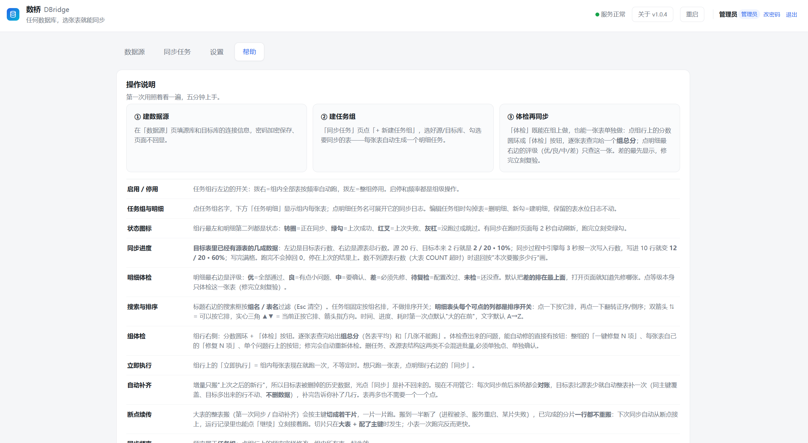
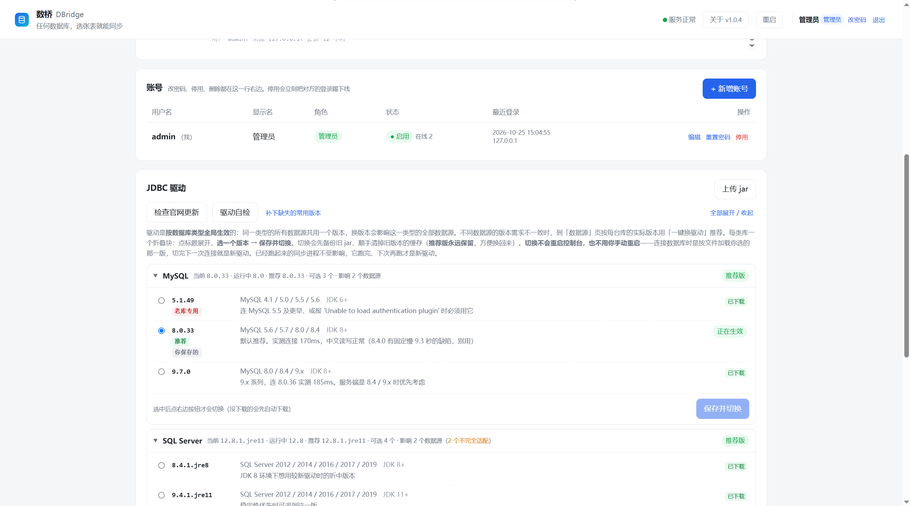

<div align="center">

# 数桥 DBridge · 数据库同步工具

**给不会写配置文件的人用的图形化数据库同步工具。选表 → 点按钮 → 数据同步过去，之后按频率自动跑。**

*DBridge · A visual database sync tool for people who don't write config files.*

免装 JDK · 内网离线可用 · 体检 → 试跑 → 正式同步三层防错护栏

[](https://github.com/nmjugtzdw/dbridge/releases)
[](LICENSE)
[]()
[]()
[]()
[](deploy/docker/README.md)

</div>

---

## 📖 简介 / Introduction

数桥（DBridge）把数据库之间的数据搬运做成了「点点鼠标就能完成」的事：不需要手写 SQL、不需要懂 SeaTunnel / 配置文件的语法，填好连接、勾选要同步的表和字段，剩下的交给程序。它会**先体检、再试跑、最后才正式同步**，全程用"人话"告诉你每一步发生了什么。

*DBridge turns cross-database data movement into a point-and-click task. No SQL, no config syntax — just fill in connections, check the tables and fields you want to sync, and let the program handle the rest. It checks first, trial-runs, then syncs for real, explaining every step in plain language.*

> ⚠️ 本仓库用于**项目介绍与公开信息展示**，不含完整源码。核心实现为闭源，这里只放少量不涉及核心逻辑的通用示例代码。
> *This repository is for project introduction and public information only. The core implementation is closed-source; only a few non-core generic example code snippets are included.*

---

## 🖼️ 界面预览 / Screenshots

### 数据源管理 / Data Sources



添加 MySQL / MariaDB / Oracle / PostgreSQL / SQL Server / TiDB / OceanBase / Greenplum 八种数据源，测试连接显示真实版本与延迟，账号密码加密存储、脱敏显示，并对低于官方支持的库版本自动给出换驱动建议。

### 同步任务 / Sync Jobs



按「任务组」组织同步任务，每组一个源库 → 目标库，勾选要同步的表；每张表实时显示同步进度、耗时、失败原因与体检评级（优 / 良 / 中 / 差）。

### 帮助与数据体检 / Help & Data Health Check



第一次照着看一遍，五分钟上手。每张表上线前可做「体检」（只读），按优/良/中/差分级，发现差异可「一键修复」。

### JDBC 驱动管理 / Driver Management



内置驱动版本兼容档案，按实际数据库版本推荐驱动，一键下载 / 替换 / 回滚，全程不用懂版本号。账号管理、多角色权限也在此页。

---

## ✨ 产品能做什么 / What It Does

- **图形化数据源管理**：MySQL / MariaDB / Oracle / PostgreSQL / SQL Server / TiDB / OceanBase / Greenplum 八种数据库，填主机、端口、账号、密码即可，测试连接一键通过。
- **选表选字段**：不用手写 SQL 或配置文件，勾选要同步的表和字段就行。
- **自动建目标表**：目标库没有对应表时自动建表，字段类型自动映射。
- **字段自动匹配**：源表与目标表字段按同名、别名、中文注释等 9 级打分自动对应，省去手工对齐。
- **定时调度**：按 cron 频率自动跑，支持全量 / 增量（水位线）同步。
- **增量水位**：按时间戳 / 自增主键推进，只同步新增和变更的数据，不重复、不漏数。
- **断点续传**：大表按主键切片搬运，中断后从断点继续，已完成分片不重搬。
- **运行历史与日志**：每次运行留痕，日志可按错误过滤、可下载。
- **试跑校验**：先读几行到临时表回读校验，确认无误再正式同步。
- **一键换驱动**：按目标库实际版本推荐并替换 JDBC 驱动，不用自己挑版本。

---

## 🛡️ 核心特点 / Core Highlights

### 三层递进，保证不会写坏数据 / Three-Layer Guard Against Data Corruption

```
体检（只读）  →  试跑（读几行写临时表）  →  正式同步（写正式表）
   随时点          正式表零改动                前置体检不过直接拒绝
```

1. **体检 / Check**：15+ 项检查（连接 / 权限 / 类型 / 主键冲突 / 非空列等），按 BLOCK / WARN / OK 分级。
2. **试跑 / Trial Run**：只读几行写进临时表，回读校验无误后自动删表，绝不碰正式表、绝不推进水位。
3. **正式同步 / Sync**：体检有 BLOCK 直接拒绝，带着已知错误去写数据这种事从一开始就不允许发生。

### 报错说人话 / Human-Readable Errors

连接失败、权限不足、类型不匹配、主键冲突等 20+ 类异常，都会被翻译成「原因 + 该干什么」，而不是甩给你一段英文堆栈。

### 增量不重复、不漏数 / Idempotent, Lossless Incremental Sync

水位取「运行开始时的最大值」，查询起点再回退，靠 upsert 吸收重叠；水位精度到毫秒，减少同秒重复读。毫秒时间戳、数字型主键等 6 种水位类型分别处理，不会出现"数字被加了引号导致排序错乱"这类隐蔽问题。

### 断网也能用 / Works Offline

数据同步在你的内网/本机跑，不依赖外网。JDBC 驱动、Java 环境都内置或可离线，常见版本驱动已预置，完全不出网的客户也能正常使用与授权。

---

## 🆚 与市面工具的对比 / Comparison

| 维度 | 数桥 DBridge | SeaTunnel / DataX | Flink CDC | SyncTool |
|---|---|---|---|---|
| 使用方式 | **图形化点选** | 写配置/代码 | 写配置/代码 | 图形化点选 |
| 免装环境 | ✅ 内置 JDK | ❌ | ❌ | ⚠️ 需 Java 17+ |
| 内网离线 | ✅ | ⚠️ | ❌ | ✅ |
| 体检/试跑护栏 | ✅ 三层 | ❌ | ❌ | ❌ |
| 数据一致性校验 | ✅ 优/良/中/差 | ❌ | ❌ | ❌ |
| 断点续传 | ✅ 切片续传 | ❌ | ✅ | ⚠️ |
| 增量同步 | ✅ 6 种水位 | ⚠️ 手动时间戳 | ✅ | ✅ |
| CDC 秒级实时 | ❌ | ⚠️ | ✅ | ❌ |
| 国产库（达梦等） | ⚠️ 部分（OceanBase） | ⚠️ 部分 | ⚠️ | ✅ |

**我们最强的三点**：① 免装环境的图形化（目标用户零门槛）；② 三层防错护栏 + 一致性校验（写坏数据前先拦住，独家）；③ 断点续传 + 增量水位（不重不漏）。

**我们暂时弱的三点**：国产库覆盖（已支持 OceanBase，达梦/金仓等在路线图）、存储过程/视图等对象同步、CDC 秒级实时——都在路线图上。


---

## 🗄️ 技术栈 / Tech Stack

| 层 | 技术 |
|---|---|
| 后端 | Java 11 · Spring Boot |
| 数据访问 | JDBC（MySQL / MariaDB / Oracle / PostgreSQL / SQL Server / TiDB / OceanBase / Greenplum 驱动） |
| 存储 | H2（嵌入式文件库） |
| 前端 | 原生 HTML / CSS / JS（单页，无框架） |
| 同步引擎 | Apache SeaTunnel |

---

## 🚀 部署方法 / Deployment

DBridge 支持三种部署方式，功能完全一致，按你的环境任选其一：

| 方式 | 适用场景 | 入口 |
|---|---|---|
| 🪟 **Windows** | 个人电脑 / Windows 服务器 | 解压 zip 双击 `启动.bat` |
| 🐧 **Linux** | Linux 服务器（裸机部署） | 解压 tar 跑启动脚本 |
| 🐳 **Docker** | 已有 Docker 环境 / 云服务器 | `docker run` 或 `docker compose` |

### 🪟 Windows 部署

分两种包，功能完全一致，只差 Java 环境：

| 包 | 大小 | 说明 |
|---|---|---|
| **lite 版** | 约 45 MB | 不含 Java。解压后先跑「环境检测.bat」，自动下载 JDK 与数据库驱动（需能上外网） |
| **full 版** | 约 100 MB | 内置 Java 11，解压即用，适合内网、不能上外网的机器 |

#### 三步装起来 / 3-Step Install

1. **解压**：把压缩包整个解压到硬盘（例如 `D:\DBridge`）。不要放 `C:\Program Files`，也不要在压缩包里直接双击运行——那里没有写权限。路径里尽量不要有中文。
2. **检测环境**：双击「环境检测.bat」，逐项检查并给出结论（`OK` / `注意` / `失败`）。缺 Java 自动下载、缺驱动自动补齐，全部通过后生成环境配置。
3. **启动**：双击「启动.bat」，等约 10 秒，浏览器打开 `http://localhost:27301`。那个黑色窗口就是服务本身，关掉即停止服务。

#### 开机自启 / Auto-Start

给「启动.bat」建快捷方式放进启动文件夹（`Win+R` → `shell:startup`），或用「任务计划程序」创建「计算机启动时」运行的任务。

### 🐧 Linux 部署

Linux 服务器裸机部署，解压后运行启动脚本即可（同样内置 Java，无需预装 JDK）：

```bash
# 1. 解压
tar -xzf dbridge-linux.tar.gz
cd dbridge

# 2. 启动（后台运行，日志写入 logs/）
./start.sh

# 3. 浏览器打开 http://服务器IP:27301
```

停止服务：`./stop.sh`（或直接 kill 进程）。

### 🐳 Docker 部署

**方式一：一键安装（推荐，无需任何前置）**

```bash
bash <(curl -sL https://dbridge.zzzmxxkj.com/install.sh)
```

自动装 Docker、下载并导入最新镜像、启动容器。升级重跑同一条，数据与授权都保留。

**方式二：自己起容器（需要先有镜像）**

```bash
# 1) 下载镜像包并导入（latest 永远指向最新版）
curl -fL -C - --progress-bar -o dbridge.tar \
  https://dbridge.zzzmxxkj.com/dist/dbridge-docker-latest.tar
docker load -i dbridge.tar

# 2) 起容器，二选一
#    a. compose（文件在仓库 deploy/docker 下）
git clone https://github.com/nmjugtzdw/dbridge && cd dbridge/deploy/docker && docker compose up -d

#    b. docker run
docker run -d --name dbridge -p 27301:27301 \
  -v dbridge-data:/opt/dbridge/data \
  -v /etc/machine-id:/etc/machine-id:ro \
  -e DBRIDGE_LICENSE_URL=https://dbridge.zzzmxxkj.com:27302 \
  -e TZ=Asia/Shanghai \
  --restart unless-stopped dbridge:latest
```

浏览器打开 `http://localhost:27301`。

> 镜像只放在我们自己的服务器上，没发到 Docker Hub，`docker pull` 拉不到。
> 内网离线：`docker save dbridge:latest -o dbridge.tar` 带到客户侧 `docker load -i`。

### 首次登录 / First Login

出厂账号 `admin`，登录后系统会引导修改密码。忘了密码可以用环境变量重置（详见交付说明）。

### 文件结构 / File Layout

| 文件 / 目录 | 用途 |
|---|---|
| `环境检测.bat` | 检查环境、自动下载 Java 与数据库驱动（Windows lite 版） |
| `启动.bat` / `start.sh` | 启动控制台（Windows / Linux） |
| `lib\dbridge.jar` | 主程序 |
| `runtime\jdk11\` | 内置 Java 11（lite 版没有，检测时下载） |
| `drivers\` | 数据库驱动（MySQL / MariaDB / Oracle / PostgreSQL / SQL Server / TiDB / OceanBase / Greenplum） |
| `data\` | 你的数据、账号等，**备份就拷这个目录** |
| `logs\` | 运行日志，出问题时打包这个目录发给支持方 |
| `work\` | 临时目录，可整个删除，会自动重建 |

---

## 📜 更新历史 / Changelog

| 版本 | 日期 | 更新内容 |
|---|---|---|
| **v1.0.8** | 2026-10-26 | 修复客户端自动激活失败（授权服务地址少了端口号，表现为一直「未激活 / 服务加载中」）；未激活时直接显示失败原因；授权天数改为累加——试用期内买卡，剩余试用天数不清零，从原到期日往后接；后台支持试用记录转正并同步合同名称 |
| v1.0.6 | 2026-10-25 | 数据库类型从 3 种扩展至 8 种（新增 Oracle / MariaDB / TiDB / OceanBase / Greenplum）；新增 Docker 容器化部署（含 SeaTunnel 同步引擎）；新增 Linux/Docker 一键拉取安装；修复若干 bug，提升稳定性 |
| v1.0.5 | 2026-10-25 | 修复若干 bug，提升稳定性；界面优化：去掉会员 Tab、新增关于页、版权沉底、会员徽章快到期提醒等 |
| v1.0.4 | 2026-10-25 | 数据源列表新增「隐私保护」按钮（一键隐藏 IP 和账号）；新增「测速」功能（延迟列 + 一键测速） |
| v1.0.3 | 2026-10-25 | 关于页新增作者信息与客服联系方式，其他细节优化 |
| v1.0.2 | 2026-10-25 | 优化关于页布局，版本号右上角增加更新提示；修复控制台中文日志乱码；首次登录不再强制改密码；修复授权状态角标不及时隐藏的问题 |
| v1.0.1 | 2026-10-24 | 客户端 lite/full 拆包 + 环境检测工具；一键升级；界面细节优化 |

> 完整的历史版本可在 [Releases](https://github.com/nmjugtzdw/dbridge/releases) 页面查看与下载。

---

## 👤 作者 / Author

- **作者 / Author**：木思丁

---

## 📁 目录说明 / Repository Layout

```
dbridge-open/
├── README.md         本文件
├── LICENSE           开源协议（示例代码部分）
├── docs/
│   └── images/       界面截图
├── deploy/
│   └── docker/       Docker 部署（Dockerfile / docker-compose.yml / 一键安装 install.sh）
└── examples/         通用示例代码（不涉及核心逻辑）
    ├── DbTypeExample.java       多数据库 JDBC 连接串拼接的通用写法
    └── CronTextExample.java     cron 表达式的人类可读解析示例
```

---

## ⚠️ 免责声明 / Disclaimer

- 本仓库仅用于**项目介绍与公开信息展示**，不含完整源码。
- `examples/` 下的代码仅作技术交流展示，可自由参考，但**不代表完整产品的实现方式**。
- 完整产品为闭源商业软件。
